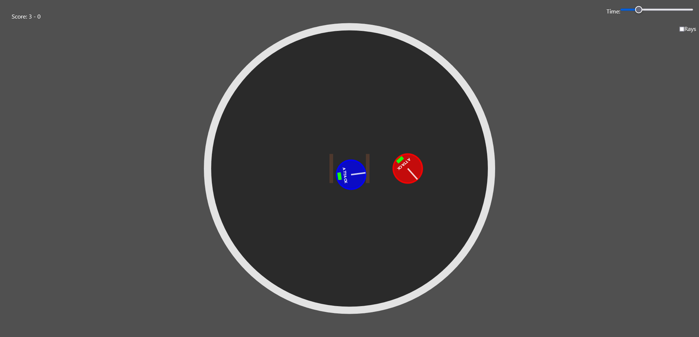

<p align="center">
  
  <br>
<a href="https://santiherranz.github.io/SumoFighters/" target="_blank"><b>Play simulator</b></a>
 </p>
  <br>

# ROBOT SUMO BATTLE

Javascript Simulator for testing robot strategies in sumo battle

Work in progress...

## Robot
- Circle body
- Heading pose
- Side bumper

## Robot movement
- Move forward / backward
- Turn left / right
- Side move left / right

## Manual Movement (Only in remote strategy)
- Arrow KEYS or WASD
- W Key = Move forward 
- W Key + SHIFT Key = Move forward double speed 
- S Key = Move backward
- A Key = Turn left
- D Key = Turn right
- A Key + SHIFT Key = Side move to the left
- D Key + SHIFT Key = Side move to the right

## Sensors
- Raycasting: +15/-15 rays or +60/-60 degrees\

- 2 vision layers: Players, Dojo boundaries
- Ground Sensors (Planned)


## Robot strategies
The goal is to push the opponent out of the ring.

- Idle, don't waste your energy
- Wait, idle some time and then change strategy
- Face opponent, spin arround and check for rays reflection to keep opponent in front
- Keep inside dojo, spin arround to detect the ring border then steer moving to the center
- Seek, face opponent and go towards him
- Flee, same as seek but in the opposite direction
- Pursue, face opponent, calculate where will be at current speed and go towards that position
- Evade, same as pursue but in the opposite direction
- Attack, Seek and push him out of the ring
- Defend, face opponent and push when contact
- Agressive defend, face opponent and push strong when contact
- Remote control

### Perception-based tactics (used by the adaptive brain)
- Search, spin towards where the opponent was last seen (or the side we were touched on) while drifting back to the centre
- Hold centre, own the middle facing the opponent; standing still and turning is almost free, so it saves energy and makes the opponent come
- Charge, aim at the perceived bearing, cruise in and escalate the push when the shove stalls
- Finish (yori-kiri), opponent near the edge: line up on the outward radius and push it straight out
- Flank, circle round the opponent (still facing it) to the inside line, between it and the centre, then push outwards
- Matador (henka), wait facing the opponent, side-step its charge towards the centre and hit its flank as it goes past
- Escape, slide towards the centre while facing the opponent; when shoved, slide perpendicular to the contact so the push slips off

Every tactic goes through a ring governor: it never drives past a safety margin before the ring-out line in the direction it moves (pushing an opponent is still allowed, it leaves first).

## Adaptive AI
Each robot panel has a **Brain** section: *Adaptive* (default) or *Classic FSM* (the original priority state machine, still tunable in *Classic FSM Tuning*).

### Perception (`scripts/perception.js`)
Only what a real robot could sense: rays, bumper, heading, battery and match clock.
- Self localisation: the dojo-layer rays always land on the ring line, so fitting a circle of known radius to their hit points (damped Gauss-Newton) tells where the centre is. Odometry carries the estimate when the robot is outside the line facing out.
- Opponent tracking: bearing and range from the player-layer rays, smoothed by an alpha-beta tracker in the ring frame; when it is out of sight its position is predicted.
- Memory and estimates: last seen position, velocity, idle time, estimated opponent energy (same energy rule as the robots), contact side.
- Opponent model: aggression (how fast it comes at us) and push balance (who wins the head-on shoves).

### Brain (`scripts/brain.js`)
- Every tick each tactic gets a utility score from the perception: edge danger, opponent near the edge, energy advantage, a tired or passive opponent, losing or stalled shoves, an incoming charge, time left (the time-out goes to the robot with more energy), energy pacing and boredom. The best one runs, with hysteresis and a minimum time per tactic; edge escapes and finishes interrupt immediately.
- Game plans (personalities) weight those scores and tune the tactics: **Bull** (charges early, pushes hard), **Matador** (side-steps and counters), **Turtle** (holds the centre, saves energy) and **Hunter** (flanks to the inside line).
- With the plan on *Auto*, a discounted UCB1 bandit picks the plan for each round from the results against this opponent (older rounds count less, so it keeps adapting if the opponent changes or learns too). The opponent profile seen in past rounds seeds the next one.
- The panel shows the live plan, tactic and reason, and the per-plan W-T-L table; *Reset learning* starts over. Settings > *Show AI perception* draws what each robot believes: the ring centre (cross) and the opponent (circle, dashed when predicted).

Manual hotkeys for robot A: 1 idle, 2 defend, 3 attack, 4 keep inside, 5 evade, 6 charge, 7 flank, 8 matador, 9 hold centre, 0 back to the brain.

### Headless arena (`tools/arena.js`)
Runs CPU vs CPU rounds in Node with the same scripts as the page (no browser), swapping start sides every round:

```
node tools/arena.js --rounds 200 --a adaptive --b classic --seed 7
node tools/arena.js --rounds 100 --a adaptive:MATADOR --b adaptive:BULL
```

Reference results (wins-ties-wins, left fighter first):

| Match | Rounds | Result | Notes |
|---|---|---|---|
| Classic vs Classic | 100 | 13-77-10 | 77 double KO: both batteries empty in ~10 s |
| Adaptive vs Classic | 100 | 99-1-0 | the adaptive robot keeps ~30 energy, the classic one runs dry and is pushed out |
| Adaptive (auto plan) vs fixed Bull | 60 | 45-14-1 | |
| Adaptive (auto plan) vs fixed Matador | 60 | 43-11-6 | |
| Adaptive (auto plan) vs fixed Hunter | 60 | 43-11-6 | |
| Adaptive (auto plan) vs fixed Turtle | 60 | 24-0-36 | Turtle vs Turtle is a coin toss on time-out, exploring the other plans costs rounds |

Fixed plans against each other (20 rounds): Turtle beats every other plan (time-outs on energy), Matador beats Bull and Hunter, Hunter beats Bull. Mirror matches of the aggressive plans (Bull, Matador, Hunter) still end mostly in double KO.

## Energy
- Movements cost energy
- Forward and backward cost is proportional to distance
- Rotation cost is porportional to time


## Effects
- Trails\n when robot moves 
- Particles\n when robots collides

## The Battle
- Battle time shall be based on three matches within three minutes
- The robot who gets two Yuko points during the battle time will be deemed the winner
- If only one Yuko Point has been won by the end of the battle time, the team which has won the Yuko Point will be deemed the winner.
- If neither of the teams wins the match within the battle time, battle time will be extended by three minutes. In the extension time, the team which gets one Yuko Point will be deemed the winner of the battle.

## Robot movements
- move forward
- move backward
- side move left
- side move right
- turn left
- turn right

## Robot movements properties
- move speed
- side move speed
- turn speed


## Strategies 
### Search
Search is continued in the direction that the opponent was last seen


## Dojo (Dohyo)
- Left side is color blue and the right side is color red.
- Starting line (Shikiri-sen)\
Located 10 cm right and left from the center of the Dojo
- White line delimits the external border of the Dojo (Tawara)\
The Tawara shall be considered as within of the Dohyo
- Check limits


## Yuko Point
If any of the following situations arises, the contestant shall get a Yuko Point:

1. Its robot makes the opponent’s robot touch any part outside the Dohyo legally.

2. The opponent's robot touches any part outside the Dohyo for any reason.

3. The opponent's robot is judged as the "Shinitai" pursuant when one or more wheels of the opponent's robot run out of the Dohyo edge, and the judge count until 3 and it cannot return into the Dohyo.


## Ranking list


## Vision
- Scan boundaries
- Raycasting
- Players layer
- Dojo boundaries layer


## All Japan Robot Sumo Tournament Official Regulation
https://www.fsi.co.jp/sumo/robot/en/rule.html


## Online virtual robot competitions.
https://roboton.io/


